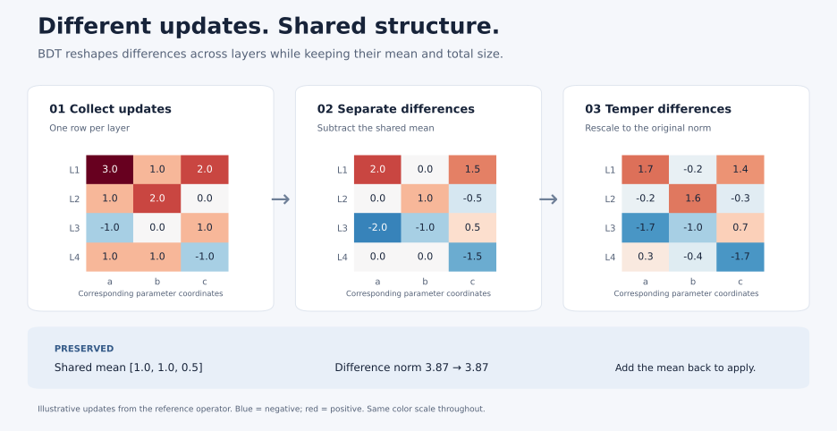

# Bounded Depth Tempering

**Exploring how Transformer layers can coordinate their optimizer updates.**

A Transformer repeats similar building blocks at different depths. Those blocks
have corresponding weight matrices, but AdamW computes each parameter's update
from its own gradient history. Could the relationships between layers provide
useful information for deciding how to update them?

**Bounded depth tempering (BDT)** explores that idea. It takes the updates AdamW
is about to apply, looks for patterns across corresponding layers, and gently
reshapes how those updates differ across depth. It preserves the average update
and the total size of the differences. The model's forward architecture stays
the same.

This project contains the method, a runnable demonstration, and experiments that
ask **whether the correspondence between parameters matters**, beyond simply
changing the size of an optimizer step.

[Try it](#try-it) · [How it works](#how-it-works) · [The experiments](#what-the-experiments-ask) · [Inside the code](docs/CODE_GUIDE.md)

## The intuition

Imagine six layers, each proposing an update to the same kind of feed-forward
weight matrix. Put those updates side by side. Some movement is shared across
all six layers; the rest describes how they move differently.

BDT keeps the shared movement. It tracks recurring patterns in the differences
and reduces the relative influence of directions with more update energy.
Afterward, it restores the total size of those differences. This lets it change
how layers move relative to one another without simply shrinking the whole step.

“High energy” means a direction accounts for more squared update magnitude;
it does not automatically mean that direction is harmful. Whether reshaping
these directions helps learning is the empirical question.

## How it works

For one group of corresponding projections:

1. **Collect the proposals.** Flatten each layer's proposed AdamW update into a
   row of a matrix. Each column represents a parameter coordinate matched across
   layers.
2. **Separate shared movement from differences.** Subtract the mean row. Keep
   that mean unchanged.
3. **Track patterns across depth.** Maintain an exponential moving average of
   normalized, centered update covariance. This describes which combinations of
   layers tend to move together or apart.
4. **Temper the differences.** Attenuate directions with larger covariance
   eigenvalues. A condition bound limits the relative scaling, and a warmup and
   ramp introduce the transformation gradually.
5. **Restore the size and mean.** Rescale the transformed differences to their
   original norm, then add back the shared update.



The mean update and the total centered norm are preserved, up to numerical
precision. Individual layers can receive different update magnitudes and
directions. Adam's moment estimates remain in their original parameter
coordinates, and decoupled weight decay is handled separately.

See [the method in detail](docs/METHOD.md) for the equations, correspondence
assumptions, and a small numerical example.

## Why correspondence matters

The same position in two weight matrices is an obvious way to pair parameters.
It is not proof that those parameters have learned the same function. Hidden
features can be represented in different orders, and layers serve different
roles at different depths.

BDT's cross-layer statistics depend on which coordinates are paired. That makes
correspondence a testable part of the method:

- **Use the original pairing:** compare matching coordinates across layers.
- **Scramble the pairing:** change which coordinates are compared, then map the
  proposed update back. Matched controls also constrain the intervention's
  geometry so the comparison goes beyond “one update was larger.”
- **Use known ancestry:** copy pretrained layers, giving parameters a known
  origin, then compare preserved and reassigned correspondence.

The question is whether a meaningful pairing contributes something that a
similarly sized transformation with a different pairing does not.

## Try it

Use Python 3.13 on macOS or Linux. From the repository root:

```bash
python3.13 -m venv .venv
make install
make demo
```

The [demo](examples/depth_update_demo.py) applies the actual BDT reference
operator to synthetic updates from six layers. It prints the transition from
warmup to active tempering, the change in update direction, and checks on the
preserved mean and norm. It runs on CPU without downloading a model or dataset.

The short warmup makes the mechanism visible in six steps. These are synthetic
updates, so the demo illustrates the transformation rather than measuring
language-model quality.

## What the experiments ask

The experiments separate three questions: which parameters are paired, how their
updates are transformed, and how update magnitude is distributed.

| Question | Experiment | Where to explore |
| --- | --- | --- |
| Does the pairing matter when the intervention's geometry is matched? | CMS1 compares AdamW, BDT, and a correspondence-scrambled matched control. | [Optimizer policy](reproducibility/studies/cms1/correspondence_matched_s1_v1/cms_policy.py) |
| What happens when a pretrained model grows by copying layers? | GCT2 studies continuation after stacked copying; FEV1 evaluates the same trained models on another partition. | [Growth study](reproducibility/studies/gct2/README.md) |
| Does preserving known ancestry matter? | BAC1 compares correspondence choices in a model with copied pretrained layers. | [Ancestry study](reproducibility/studies/bac1/README.md) |
| How much comes from distributing update magnitude? | BCT1 and BCT2 compare budget choices with a shared direction construction; BCT2 uses four fresh parents. | [Evidence coverage](reproducibility/docs/COVERAGE.md), [BCT2 records](reproducibility/docs/BCT2_RECORDS.md) |

Saved results include improvements in the studied settings. Their interpretation
depends on the control, training setup, and independent parent models. They do
not establish that BDT is universally better than AdamW or faster in wall-clock
time. The small covariance matrix also does not make transforming large update
matrices computationally free.

You can inspect and recompute the saved comparisons with `make analysis`.
Outputs go into a new `reproducibility/build/all_records/` directory. The
[coverage guide](reproducibility/docs/COVERAGE.md) records which results have
original receipts, compact score records, or displayed-precision evidence.

## Explore the implementation

| Start with | What you will find |
| --- | --- |
| [Demo](examples/depth_update_demo.py) | A short, executable introduction to the transformation |
| [Method guide](docs/METHOD.md) | Equations and the choices behind the operator |
| [Code guide](docs/CODE_GUIDE.md) | A path from the operator to the optimizer and training drivers |
| [Reference operator](reproducibility/studies/cms1/fair_depth_lr_bracketing_v2/tempering_reference.py) | Covariance tracking, bounded scaling, and state handling |
| [Research release](reproducibility/README.md) | Study protocols, saved evidence, and reproduction commands |

The original implementations and evidence live together under
`reproducibility/` to preserve their source identities. The guides and examples
provide a shorter path through that material.

## Check the project

```bash
make verify   # Source hashes and saved BCT2 receipts; standard library only
make test     # CPU numerical and record-handling tests
make check    # Verification, tests, and the demo
```

The repository includes training implementations and saved results. Full-scale
training additionally requires external datasets, checkpoints, and compute;
those assets are not bundled. Passing the CPU tests or recomputing recorded
scores is distinct from rerunning the training experiments.

For development, see [Contributing](CONTRIBUTING.md). For source provenance and
reuse terms, see [Third-party notices](reproducibility/THIRD_PARTY_NOTICES.md).
No blanket open-source license is asserted for the preserved research release.
